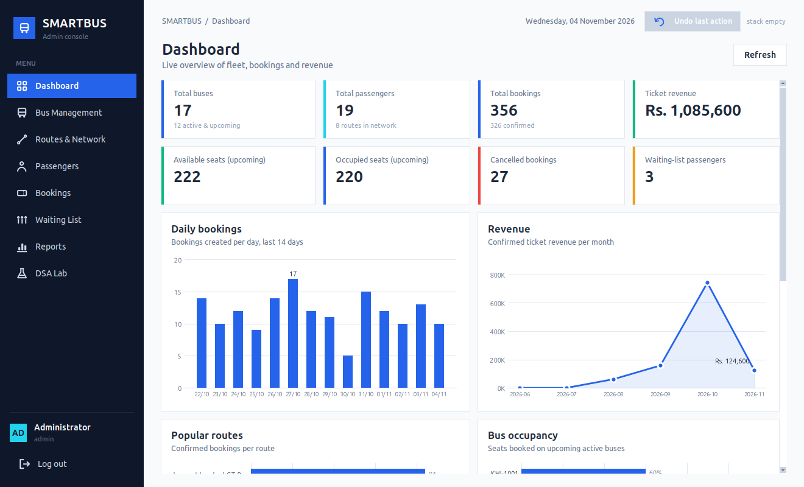
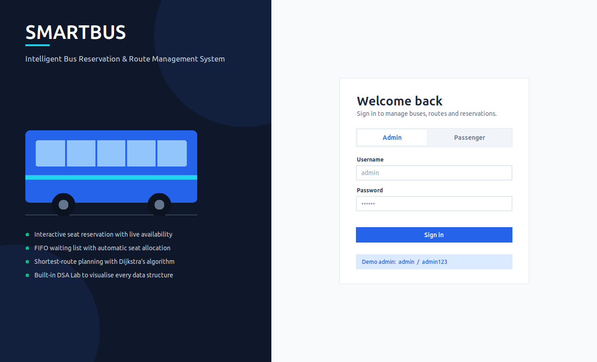
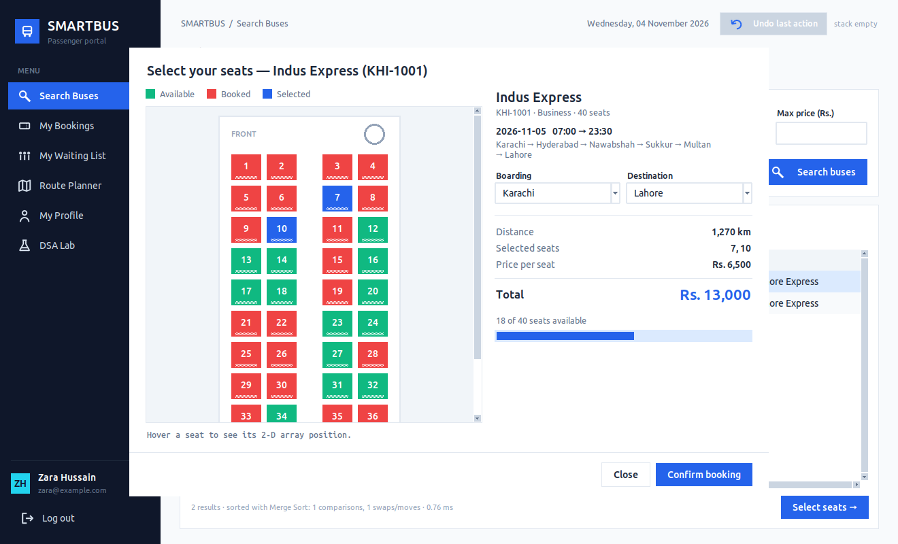
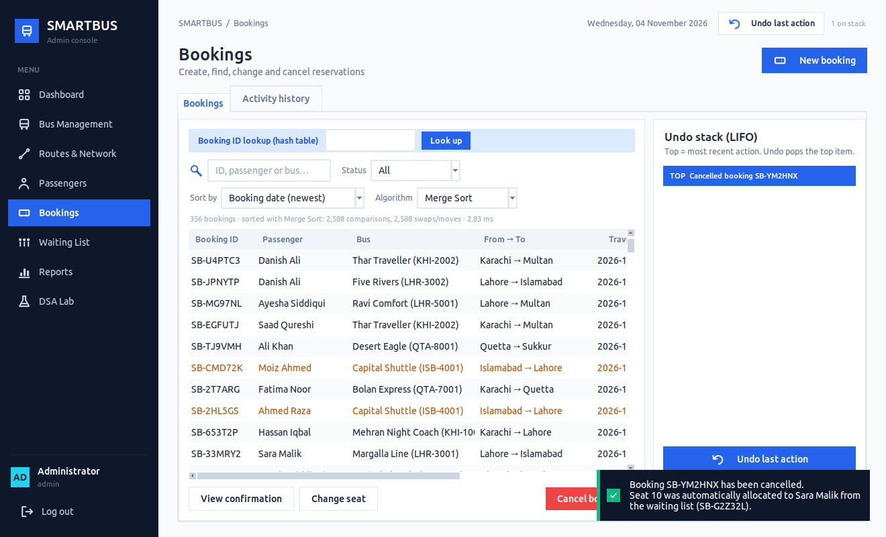
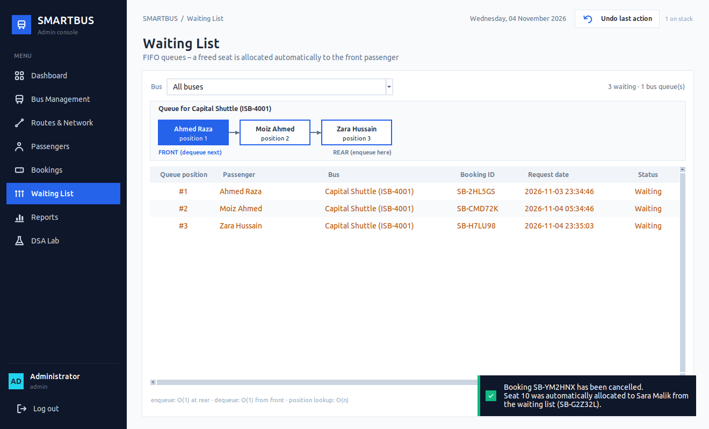
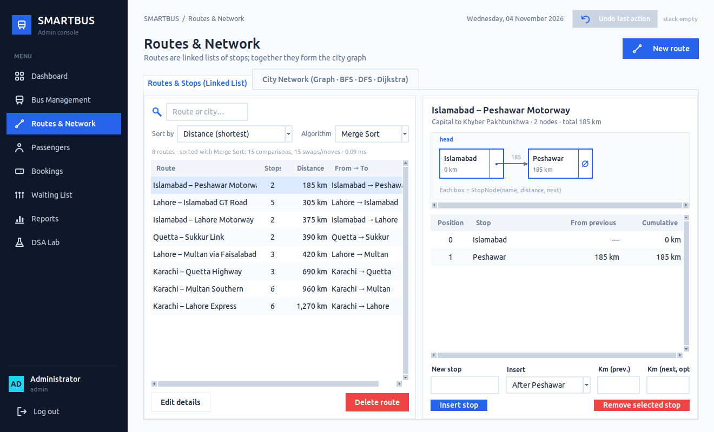
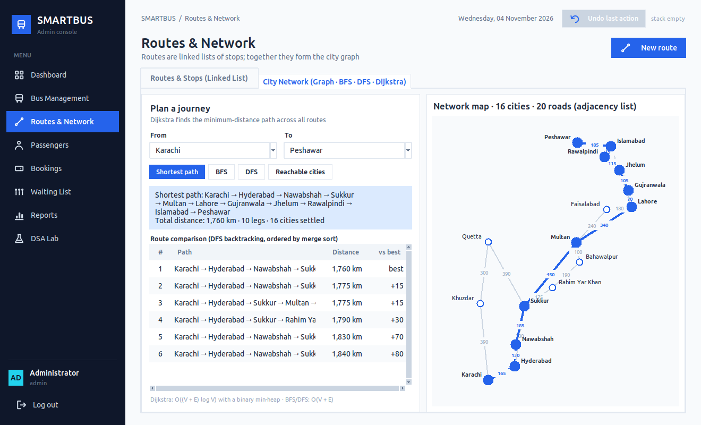
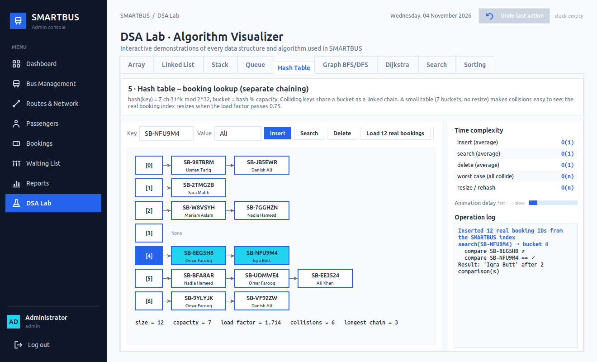
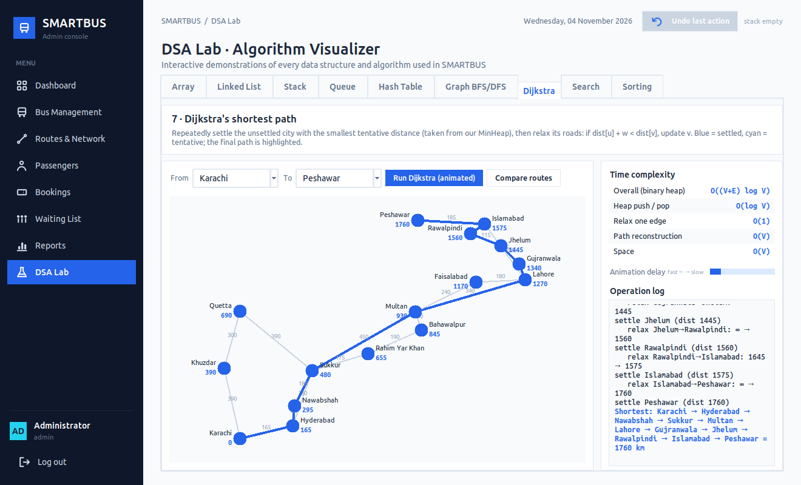
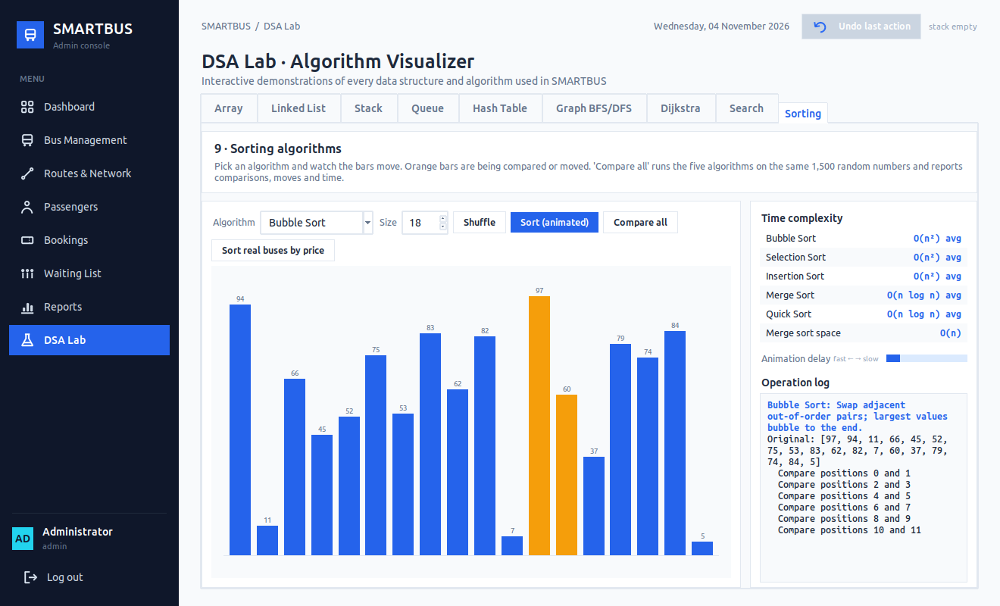

# SMARTBUS – Intelligent Bus Reservation & Route Management System

SMARTBUS is a desktop application written in **Python 3** with a **Tkinter/ttk** interface and an
**SQLite** database. It is a complete bus reservation system: administrators manage buses,
routes, passengers and bookings, and passengers search for buses, choose seats on an interactive
seat map, cancel tickets and join waiting lists.

The project was built for a university **Data Structures and Algorithms** course. Every core
data structure and algorithm (array, linked list, stack, queue, hash table, graph, BFS, DFS,
Dijkstra, linear and binary search, and five sorting algorithms) is **implemented by hand** in
Python. Each one does real work in the application, and a built-in **DSA Lab** shows each one
step by step.



---

## Table of contents

1. [Objectives](#1-objectives)
2. [Features](#2-features)
3. [Technology stack](#3-technology-stack)
4. [Folder structure](#4-folder-structure)
5. [Installation](#5-installation)
6. [Running the application](#6-running-the-application)
7. [Demo accounts](#7-demo-accounts)
8. [Database structure](#8-database-structure)
9. [DSA implementation overview](#9-dsa-implementation-overview)
10. [Time complexities](#10-time-complexities)
11. [Screenshots](#11-screenshots)
12. [Testing](#12-testing)
13. [Suggested demonstration script](#13-suggested-demonstration-script)
14. [Further documentation](#14-further-documentation)

---

## 1. Objectives

* Build a realistic, fully working bus reservation system.
* Show how fundamental data structures and algorithms solve real transport problems.
* Keep **persistent data** (SQLite) and **in-memory DSA structures** synchronised at all times.
* Give a clean, modern desktop interface that is easy to demonstrate.

## 2. Features

| Module | What you can do |
|---|---|
| **Authentication** | Admin and passenger login, passenger self-registration, logout, PBKDF2-SHA256 password hashing |
| **Admin dashboard** | 8 live statistic cards and 4 charts (daily bookings, monthly revenue, popular routes, bus occupancy), plus recent bookings |
| **Bus management** | Add, edit, delete, search and sort buses. Binary-search lookup by bus number. Deleting a bus with active bookings is blocked; *Cancel bus* cancels them safely first |
| **Route management** | Create routes, insert stops at any position, remove stops, edit details. Visual linked-list view |
| **City network** | Graph of all cities. BFS, DFS, reachable cities, Dijkstra shortest path, and a comparison of alternative routes on a map |
| **Passenger management** | Register, edit, safely delete, search, sort, binary-search by email, view booking history |
| **Bus search** | Filter by departure city, destination, date, departure time, maximum price and minimum free seats. Sort by cheapest, earliest, shortest distance or most seats, with a choice of sorting algorithm |
| **Seat reservation** | Interactive seat map (green = available, red = booked, blue = selected), multi-seat selection, live total price, unique booking IDs, printable confirmation |
| **Booking management** | Hash-table lookup by booking ID, cancel, change seat, confirmation view, status tracking (Confirmed / Cancelled / Waiting), activity history |
| **Waiting list** | FIFO queue per bus. When a seat is cancelled, it is automatically given to the first passenger in the queue |
| **Undo** | *Undo last action* (stack) for book, cancel, change seat and join waiting list, with safety checks |
| **Reports** | Daily bookings, monthly revenue, passengers, bus occupancy, route popularity, cancellations, all exportable to CSV |
| **DSA Lab** | Nine interactive visualisers with step logs and complexity tables |

## 3. Technology stack

| Purpose | Technology |
|---|---|
| Language | Python 3.9+ (tested with Python 3.12) |
| GUI | Tkinter + ttk (`clam` theme, custom styling) |
| Database | SQLite through the standard `sqlite3` module |
| Charts | Matplotlib (optional; the dashboard shows a notice if it is missing) |
| Password hashing | `hashlib.pbkdf2_hmac` (SHA-256, random salt, 100,000 iterations) |
| Tests | `unittest`-style tests, run with pytest or `python -m unittest` |

No web frameworks, external services or APIs are used. Everything runs locally.

## 4. Folder structure

```
dsa-project/                     ← project root ("SMARTBUS")
├── main.py                      entry point – python main.py
├── requirements.txt
├── README.md
├── conftest.py                  pytest path set-up
├── database/
│   ├── schema.sql               tables, constraints, indexes
│   ├── database.py              connection, transactions (with savepoints)
│   └── seed.py                  demo data (runs automatically on first launch)
├── models/                      dataclasses: Bus, Passenger, Booking, Route …
├── data_structures/             ★ hand-written data structures
│   ├── custom_array.py          FixedArray + SeatMatrix (2-D seat array)
│   ├── linked_list.py           RouteLinkedList (singly linked list of stops)
│   ├── stack.py                 Stack (LIFO, linked nodes)
│   ├── queue.py                 Queue (FIFO, front/rear pointers)
│   ├── hash_table.py            HashTable (separate chaining, resizing)
│   ├── graph.py                 Graph (adjacency list, BFS, DFS)
│   └── priority_queue.py        MinHeap used by Dijkstra
├── algorithms/                  ★ hand-written algorithms
│   ├── searching.py             linear search, binary search
│   ├── sorting.py               bubble, selection, insertion, merge, quick sort
│   └── shortest_path.py         Dijkstra + alternative-route enumeration
├── services/                    business logic
│   ├── app_context.py           wires the database and all services together
│   ├── auth_service.py
│   ├── bus_service.py
│   ├── passenger_service.py
│   ├── booking_service.py       ★ hash table + seat arrays + queues + undo stacks
│   ├── route_service.py         linked lists + graph
│   └── report_service.py
├── ui/                          Tkinter screens
│   ├── theme.py, components.py  shared styles and reusable widgets
│   ├── login_window.py, main_window.py
│   ├── admin_panel.py, passenger_panel.py   navigation for each role
│   ├── dashboard.py, bus_management.py, route_management.py
│   ├── passenger_management.py, booking_management.py
│   ├── seat_selection.py, waiting_list.py, reports.py
│   └── dsa_lab.py               ★ DSA Lab / algorithm visualiser
├── utils/                       constants, validators, helpers, exceptions
├── tests/                       68 automated tests
├── assets/icons/                PNG icons (+ generate_icons.py)
├── docs/
│   ├── DSA_EXPLANATION.md
│   ├── PROJECT_REPORT.md
│   └── screenshots/
└── data/smartbus.db             created automatically on first launch
```

## 5. Installation

1. **Install Python 3.9 or newer** from <https://www.python.org/downloads/>.
   On Windows, keep the *tcl/tk and IDLE* option ticked during installation.
2. **Make sure Tkinter is available.** It ships with Python on Windows and macOS. On Linux it
   is often a separate package:

   ```bash
   # Ubuntu / Debian
   sudo apt install python3-tk
   # Fedora
   sudo dnf install python3-tkinter
   ```

   Check it with `python3 -m tkinter`. A small test window should open.
3. **(Recommended) create a virtual environment and install the optional packages:**

   ```bash
   cd dsa-project
   python3 -m venv .venv
   # Windows: .venv\Scripts\activate     macOS/Linux: source .venv/bin/activate
   pip install -r requirements.txt
   ```

   On Linux, a virtual environment uses the system's Tkinter, so step 2 is still needed.

## 6. Running the application

```bash
python main.py
```

(Use `python3 main.py` on macOS/Linux if `python` points to Python 2, or
`.venv/bin/python main.py` to use the virtual environment.)

On the first launch SMARTBUS creates `data/smartbus.db` and fills it with demo data:
17 buses, 8 routes, 16 cities, 18 passengers, about 350 bookings and a full bus with a waiting
list. You do not need to configure anything.

**Reset to fresh demo data** (deletes the current database):

```bash
python -m database.seed --reset
```

Dates in the demo data are generated relative to *today*, so there are always upcoming trips to
book.

## 7. Demo accounts

| Role | Username / Email | Password |
|---|---|---|
| **Admin** | `admin` | `admin123` |
| Passenger | `ali.khan@example.com` | `pass123` |
| Passenger | `sara.malik@example.com` | `pass123` |
| Passenger | `moiz.ahmed@example.com` | `pass123` |

All 18 demo passengers use the password `pass123` (see `database/seed.py` for the full list).
You can also create a new passenger account from the login screen.

## 8. Database structure

| Table | Purpose | Key constraints |
|---|---|---|
| `users` | Login accounts (admin/passenger) | `username` UNIQUE, `role` CHECK, salted hash |
| `passengers` | Passenger profiles | `email` UNIQUE, FK → `users` (CASCADE) |
| `routes` | Route names and descriptions | `route_name` UNIQUE |
| `route_stops` | One row per **linked-list node**, in `stop_order` | UNIQUE(route, order), UNIQUE(route, stop) |
| `buses` | Fleet and schedules | `bus_number` UNIQUE, seats/price CHECK > 0, FK → `routes` (RESTRICT) |
| `bookings` | One row per seat reservation | status CHECK, **partial UNIQUE index on (bus, seat) for confirmed bookings** |
| `waiting_list` | FIFO queue entries; `waiting_id` stores arrival order | `booking_id` UNIQUE |
| `booking_history` | Log of every operation; used to rebuild undo stacks | `undoable` / `undone` flags |

Design notes:

* **Parameterised SQL everywhere** (`?` placeholders), which prevents SQL injection.
* **Transactions.** Every multi-step change (for example *cancel booking + allocate seat to a
  waiting passenger*) runs inside one `BEGIN IMMEDIATE … COMMIT`. Nested service calls use
  SAVEPOINTs.
* **Double booking is impossible** at database level:
  `CREATE UNIQUE INDEX ux_bookings_active_seat ON bookings(bus_id, seat_number) WHERE status='Confirmed'`.
* Bookings keep **snapshots** (`passenger_name`, `bus_label`, `route_name`), so reports stay
  correct even after a passenger or bus is deleted.

## 9. DSA implementation overview

The database stores data **permanently**; the custom data structures do the **work**. At start-up
SMARTBUS loads the records into the structures below. After every change, memory is updated
**only after** the SQLite transaction commits, so memory and database never disagree.

| Structure / algorithm | File | Where SMARTBUS uses it |
|---|---|---|
| **Array (2-D)** | `data_structures/custom_array.py` | Seat map of every bus (`0` = available, `1` = booked). The seat screen draws directly from it |
| **Singly linked list** | `data_structures/linked_list.py` | Each route's ordered stops; insert/remove stops; route distance; segment distance in bus search |
| **Stack** | `data_structures/stack.py` | Undo history per user (book / cancel / change / waitlist) |
| **Queue** | `data_structures/queue.py` | Waiting list per bus; automatic FIFO seat allocation |
| **Hash table** | `data_structures/hash_table.py` | Booking-ID → booking index (also seat maps, queues and undo stacks keyed by ID) |
| **Graph** | `data_structures/graph.py` | City network built from all routes; BFS/DFS; reachable cities |
| **Min-heap** | `data_structures/priority_queue.py` | Priority queue inside Dijkstra (written by hand instead of `heapq`) |
| **Dijkstra** | `algorithms/shortest_path.py` | Route Planner and Routes & Network screen |
| **Linear search** | `algorithms/searching.py` | All "contains" filters (name, email, route, bus) |
| **Binary search** | `algorithms/searching.py` | Exact lookup of a bus number or passenger email (list sorted with merge sort first) |
| **5 sorting algorithms** | `algorithms/sorting.py` | Every sortable table. The user picks *which* algorithm sorts the table, and the comparison count is displayed |

Python's built-in `sorted()`, `list.sort()`, `bisect` and `heapq` are **not used** in the
application code. (The test suite uses `sorted()` once, only as an independent check that our
sorting algorithms give the right answer.)

A full explanation for each structure is in **[docs/DSA_EXPLANATION.md](docs/DSA_EXPLANATION.md)**.

## 10. Time complexities

| Operation | Complexity |
|---|---|
| Seat access / reserve / release (array) | O(1) |
| Count available seats (array traversal) | O(n) |
| Linked list insert at position k / delete / search | O(k) / O(n) / O(n) |
| Stack push / pop / peek | O(1) |
| Queue enqueue / dequeue / peek | O(1) |
| Hash table insert / search / delete | O(1) average, O(n) worst |
| Graph BFS / DFS | O(V + E) |
| Dijkstra with binary heap | O((V + E) log V) |
| Linear search | O(n) |
| Binary search | O(log n) |
| Bubble / Selection / Insertion sort | O(n²) average (Bubble & Insertion O(n) best) |
| Merge sort | O(n log n) always, O(n) extra space |
| Quick sort | O(n log n) average, O(n²) worst |

## 11. Screenshots

| | |
|---|---|
| **Login**  | **Seat selection**  |
| **Cancellation → automatic FIFO allocation**  | **Waiting list queue**  |
| **Route as a linked list**  | **Dijkstra on the city network**  |
| **DSA Lab – hash table**  | **DSA Lab – Dijkstra animation**  |
| **DSA Lab – sorting**  | |

## 12. Testing

```bash
pip install pytest            # once
python -m pytest -v           # run all 68 tests
# or, without pytest:
python -m unittest discover -s tests -t .
```

| Test file | Covers |
|---|---|
| `test_array.py` | indexing formula, padding cells, reserve/release, duplicate prevention, full bus |
| `test_linked_list.py` | insert head/middle/tail, delete head/middle/tail, search, position, distances |
| `test_stack.py` | LIFO order, empty-stack errors, bounded stack |
| `test_queue.py` | FIFO order, empty-queue errors, rear-pointer reset, removal from the middle |
| `test_hash_table.py` | insert/update/delete, missing keys, forced collisions (capacity 1), resizing |
| `test_graph.py` | connections, BFS/DFS, Dijkstra, unreachable cities, same-city path, alternative routes |
| `test_algorithms.py` | linear/binary search, all 5 sorts on random/empty/sorted/reversed data, stability, min-heap |
| `test_booking.py` | full workflow on a temporary database: login, registration validation, booking, double-booking prevention, rollback, cancellation, FIFO auto-allocation, undo rules, **restart persistence**, safe deletes, route edits, bus search, reports/CSV |

Latest result: **68 passed**.

## 13. Suggested demonstration script

1. Sign in as **admin** and show the **Dashboard**. All numbers come from the database.
2. **Waiting List**: *Capital Shuttle (ISB-4001)* is full and three passengers are queued
   (Sara → Ahmed → Moiz).
3. **Bookings**: filter by "Capital", cancel one confirmed seat. A notification confirms that
   the seat went to **Sara**, the front of the queue. Open *Waiting List* again: Ahmed is now first.
4. Press **Undo last action**. SMARTBUS refuses, because restoring the cancelled booking would
   take Sara's seat. This shows that undo never breaks the waiting-list rules.
5. **Bookings → Booking ID lookup**: paste any ID to show the hash bucket and the number of
   comparisons.
6. **Routes & Network**: insert a stop into a route and watch the linked list change. Then, on
   the *City Network* tab, find the shortest path Karachi → Peshawar and compare alternatives.
7. **DSA Lab**: run the queue demo (Ali, Ahmed, Moiz, dequeue), the stack demo (A, B, C, pop),
   BFS/DFS, the animated Dijkstra, the binary-search benchmark and a sorting animation.
8. Log out and sign in as a passenger. Search Karachi → Lahore, pick seats on the seat map,
   confirm, then undo the booking.

### How undo behaves after a restart

Every undoable operation is saved in `booking_history`. When a user signs in again, their last
25 operations that have not been undone are pushed back onto their stack in the original order,
so **undo still works after the application restarts**. Before reversing anything, SMARTBUS
re-checks the *current* state (is the seat still free? is anyone waiting? has the bus
departed?). If the action can no longer be reversed safely, it is removed from the stack with an
explanation.

## 14. Further documentation

* **[docs/DSA_EXPLANATION.md](docs/DSA_EXPLANATION.md)**: why each data structure was chosen,
  how it works and where it is used.
* **[docs/PROJECT_REPORT.md](docs/PROJECT_REPORT.md)**: university project report (problem
  statement, requirements, architecture, database design, testing, conclusion).
